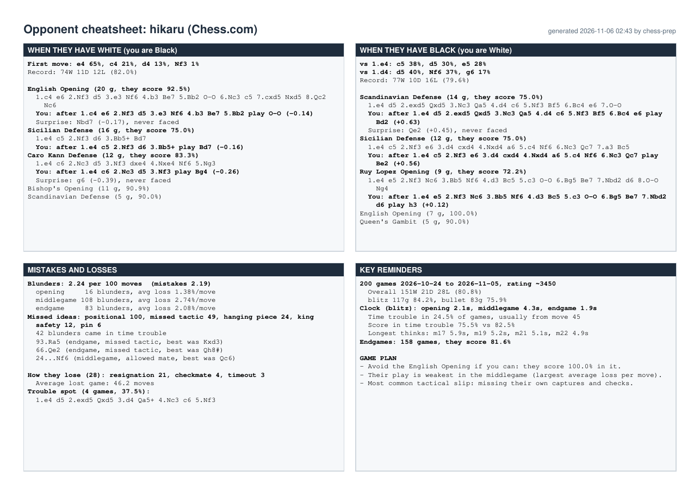

# chess-prep

Scout a chess opponent from their public games, get a one-page cheatsheet, and practise against a bot that plays like them.

[](examples/hikaru/cheatsheet.pdf)

*A real cheatsheet from `chessprep run hikaru --site chesscom --max 200`. See [`examples/hikaru/`](examples/hikaru/) for the [PDF](examples/hikaru/cheatsheet.pdf), the opening tree, the full report and the terminal output.*

## What it does

You give `chessprep` a username from Chess.com or Lichess. It then:

1. **Downloads their recent games** through the sites' free public APIs. No account or API key needed.
2. **Finds their weak spots.** Stockfish checks every position, and the tool counts blunders, sorts them by type (hanging pieces, forks, missed tactics and so on), and looks at their clock habits, endgames and the openings where they score badly.
3. **Builds your opening prep.** A move tree of their main openings, the point where you have to choose a move, the engine's best replies, and a "surprise" move they have never faced.
4. **Makes a cheatsheet** you can print or keep on your phone: one A4 page as PDF, plus Markdown and plain text.
5. **Lets you practise against a clone.** A bot that plays their openings move for move, repeats their moves in positions they have reached before, and otherwise plays like a human of their rating (Maia) or a strength-limited Stockfish. Play in the terminal or in your browser.

Everything runs on your own computer.

## Set it up with Claude Code

If you use [Claude Code](https://claude.com/claude-code), it can do the whole setup for you:

1. Install Claude Code.
2. Download this project (step 2 below) and open a terminal in the `chess-prep` folder.
3. Run:

   ```bash
   claude "Read SETUP_WITH_CLAUDE.md and set this project up for me"
   ```

It checks your system, installs what is missing (it asks before using `sudo`), runs the tests and does a first real run with you.

## Getting started

### 1. What you need

- **Python 3.10 or newer** (3.12 recommended)
- **git** (to download the code)
- An internet connection

Install them if you do not have them yet:

| System | Command |
|---|---|
| Ubuntu / Debian | `sudo apt update && sudo apt install python3.12 python3.12-venv git` |
| macOS ([Homebrew](https://brew.sh)) | `brew install python@3.12 git` |
| Windows | `winget install Python.Python.3.12` and then `winget install Git.Git` |

On Ubuntu 22.04 and older, `python3.12` is not in the default package list. Use the Python your system has if it is 3.10 or newer, or add the deadsnakes PPA (`sudo add-apt-repository ppa:deadsnakes/ppa`).

Check that it worked:

```bash
python3 --version     # Windows: py --version
git --version
```

### 2. Download the code

```bash
git clone https://github.com/iwdissi-rl/chess-prep.git
cd chess-prep
```

### 3. Install it

The simplest way is a virtual environment inside the folder:

```bash
python3 -m venv .venv              # Windows: py -m venv .venv
source .venv/bin/activate          # Windows: .venv\Scripts\activate
pip install .
```

Or, if you have [pipx](https://pipx.pypa.io) (`sudo apt install pipx`, `brew install pipx`, or on Windows `py -m pip install --user pipx`), install it as a normal command you can run from anywhere:

```bash
pipx install .
```

Want the optional browser board for practice? Use `pip install ".[web]"` (or `pipx install ".[web]"`).

### 4. Check your setup

```bash
chessprep doctor
```

This lists what is installed and what is missing, and prints the exact command to fix each problem. Stockfish will show as missing at first. That is expected.

### 5. Install the chess engines

```bash
chessprep setup-engines
```

This downloads the official Stockfish build for your system (about 80 MB) and the small Maia weight files into the chess-prep data folder. If you already have Stockfish installed (for example with `sudo apt install stockfish` or `brew install stockfish`), `chessprep` finds it on its own.

Lc0 is optional. It lets the practice bot use Maia, a neural network trained to play like human players of a given rating. Without it, the bot uses the player's own moves plus a Stockfish limited to their rating. `chessprep doctor` shows how to install Lc0 on your system.

### 6. Your first run

Let's scout Hikaru Nakamura, whose games on Chess.com are public:

```bash
chessprep run hikaru --site chesscom --max 200
```

This downloads his 200 most recent games, analyses them, builds the prep and writes the cheatsheet. On a normal laptop it takes a few minutes. Most of that time is Stockfish. This is the output of a real run on 6 November 2026 (your numbers will differ, because his games keep changing):

```text
───────────────────────── 1/4 Fetch hikaru (Chess.com) ─────────────────────────

Done. 200 new games, 0 already stored, 0 skipped (variants or unfinished). 200 
games stored for hikaru (Chess.com).
───────────────────────────────── 2/4 Analyze ──────────────────────────────────

Engine pass done. 17032 positions analysed, 0 already known.
╭───────────── hikaru (Chess.com) ──────────────╮
│ Games          200 (2026-10-24 to 2026-11-05) │
│ Recent rating  3450                           │
│ Overall        151W 21D 28L  (80.8%)          │
│ As white       74W 11D 12L  (82.0%)           │
│ As black       77W 10D 16L  (79.6%)           │
╰───────────────────────────────────────────────╯
                      Main openings                      
┏━━━━━━━━━━━┳━━━━━━━━━━━━━━━━━━━━━━┳━━━━━━━┳━━━━━━━━━━━━┓
┃ They play ┃ Opening              ┃ Games ┃ They score ┃
┡━━━━━━━━━━━╇━━━━━━━━━━━━━━━━━━━━━━╇━━━━━━━╇━━━━━━━━━━━━┩
│ white     │ English Opening      │    20 │      92.5% │
│ white     │ Sicilian Defense     │    16 │      75.0% │
│ white     │ Caro Kann Defense    │    12 │      83.3% │
│ black     │ Scandinavian Defense │    14 │      75.0% │
│ black     │ Sicilian Defense     │    12 │      75.0% │
│ black     │ Ruy Lopez Opening    │     9 │      72.2% │
└───────────┴──────────────────────┴───────┴────────────┘
Mistakes: 2.24 blunders and 2.19 mistakes per 100 moves; most common: 
positional, missed tactic, hanging piece
╭──────────────────────────────── Game plan ─────────────────────────────────╮
│ - Avoid the English Opening if you can: they score 100.0% in it.           │
│ - Their play is weakest in the middlegame (largest average loss per move). │
│ - Most common tactical slip: missing their own captures and checks.        │
╰────────────────────────────────────────────────────────────────────────────╯
Report saved: ~/Documents/chess-prep/chesscom-hikaru/report.json
─────────────────────────────────── 3/4 Prep ───────────────────────────────────
                              Your decision points                              
┏━━━━━━━━━━━┳━━━━━━━━━━━━━━━━━━━┳━━━━━━━━━━━━━━━━━━━┳━━━━━━┳━━━━━━━━━━━━━━━━━━━┓
┃ They play ┃ Opening           ┃ After             ┃ Play ┃ Surprise          ┃
┡━━━━━━━━━━━╇━━━━━━━━━━━━━━━━━━━╇━━━━━━━━━━━━━━━━━━━╇━━━━━━╇━━━━━━━━━━━━━━━━━━━┩
│ white     │ English Opening   │ 1.c4 e6 2.Nf3 d5  │ O-O  │ Nbd7              │
│           │                   │ 3.e3 Nf6 4.b3 Be7 │      │                   │
│           │                   │ 5.Bb2             │      │                   │
│ white     │ Sicilian Defense  │ 1.e4 c5 2.Nf3 d6  │ Bd7  │ -                 │
│           │                   │ 3.Bb5+            │      │                   │
│ white     │ Caro Kann Defense │ 1.e4 c6 2.Nc3 d5  │ Bg4  │ g6                │
│           │                   │ 3.Nf3             │      │                   │
│ black     │ Scandinavian      │ 1.e4 d5 2.exd5    │ Bd2  │ Qe2               │
│           │ Defense           │ Qxd5 3.Nc3 Qa5    │      │                   │
│           │                   │ 4.d4 c6 5.Nf3 Bf5 │      │                   │
│           │                   │ 6.Bc4 e6          │      │                   │
│ black     │ Sicilian Defense  │ 1.e4 c5 2.Nf3 e6  │ Be2  │ (same, never      │
│           │                   │ 3.d4 cxd4 4.Nxd4  │      │ faced)            │
│           │                   │ a6 5.c4 Nf6 6.Nc3 │      │                   │
│           │                   │ Qc7               │      │                   │
│ black     │ Ruy Lopez Opening │ 1.e4 e5 2.Nf3 Nc6 │ h3   │ (same, never      │
│           │                   │ 3.Bb5 Nf6 4.d3    │      │ faced)            │
│           │                   │ Bc5 5.c3 O-O      │      │                   │
│           │                   │ 6.Bg5 Be7 7.Nbd2  │      │                   │
│           │                   │ d6                │      │                   │
└───────────┴───────────────────┴───────────────────┴──────┴───────────────────┘
Prep tree saved: ~/Documents/chess-prep/chesscom-hikaru/prep.md
──────────────────────────────── 4/4 Cheatsheet ────────────────────────────────
╭─────── Cheatsheet ready ────────╮
│ PDF  ~/Documents/chess-prep/chesscom-hikaru/cheatsheet.pdf │
│ MD   ~/Documents/chess-prep/chesscom-hikaru/cheatsheet.md  │
│ TXT  ~/Documents/chess-prep/chesscom-hikaru/cheatsheet.txt │
╰─────────────────────────────────╯
```

Open `cheatsheet.pdf` to see the one-page summary. `prep.md` in the same folder has the full opening tree. The files from this run are in [`examples/hikaru/`](examples/hikaru/), including [the PDF](examples/hikaru/cheatsheet.pdf).

Then play a practice game against the clone:

```bash
chessprep practice hikaru --color black
```

Type moves like `e5`, `Nf6`, `O-O` or `e7e5`. Type `hint` for a Stockfish suggestion, `moves` to list legal moves, `undo` to take back, and `resign` to stop.

Not sure what to type? Run `chessprep` with no arguments and pick from the menu.

## Commands

| Command | What it does |
|---|---|
| `chessprep` | Opens an interactive menu. |
| `chessprep fetch USER --site chesscom\|lichess` | Downloads recent games. `--max 200` sets how many. `--speed blitz,rapid` keeps only some speeds. |
| `chessprep analyze USER` | Runs Stockfish over every position, then writes the weakness report. `--depth 12`, `--workers N`, `--no-engine` |
| `chessprep prep USER` | Builds the opening tree with suggested replies. `--depth 18`, `--no-engine` |
| `chessprep cheatsheet USER` | Writes `cheatsheet.pdf`, `.md` and `.txt`. |
| `chessprep run USER --site ...` | Does all four steps above in a row. |
| `chessprep practice USER` | Plays against the clone in the terminal. `--color white\|black\|random`, `--games 3`, `--web` for the browser board, `--history` for your past results. |
| `chessprep players` | Lists the players you have downloaded. |
| `chessprep doctor` | Checks your setup and tells you how to fix problems. |
| `chessprep setup-engines` | Downloads Stockfish and the Maia weights. `--lc0` also downloads Lc0 (Windows only). |
| `chessprep config show` / `set KEY PATH` / `unset KEY` | Shows or changes saved engine paths (`stockfish`, `lc0`, `maia_dir`). |

Every command that writes files takes `--out FOLDER` to choose where they go. `--site` is only needed after `fetch` if the same name exists on both sites. Add `--help` to any command for all options.

For demos and scripts, `practice` can run without typing: `--moves "e4 Nf3 Bc4"` plays those moves for you, and `--auto 10` lets Stockfish play 10 of your moves. Both stop after that.

## How it works

**Fetching.** Chess.com publishes each player's games month by month, and Lichess streams them on request. `chessprep` reads the newest games first, skips variants such as Chess960, and stores each player in a small SQLite database. A name on Chess.com and the same name on Lichess are treated as two different people.

**Analysis.** Every unique position in the games is evaluated once by Stockfish and cached, so fetching more games later only analyses the new positions. A move counts as an inaccuracy, mistake or blunder when it drops the player's winning chances by 5, 10 or 15 percentage points. Lichess uses the same idea. Blunders are sorted by type based on the engine's best reply, for example a capture of an undefended piece (hanging piece) or a knight attacking two pieces (fork). The report also covers results by colour and speed, clock use and time trouble, endgames, and positions they reached several times and scored badly from.

**Prep.** For their three most played openings with each colour, `chessprep` builds a tree of the moves that were actually played, with how often each was played and how they scored. It then finds the most common position where it is your move, asks Stockfish for the best replies, and suggests a "surprise" move that is nearly as good but that they have never faced there.

**The clone.** When choosing a move, the bot tries in this order:

1. Their opening book: what they played after this exact sequence of moves.
2. Their history: what they played in this position, even if it came from a different move order. With Maia installed, 70% of the time it plays their move and 30% of the time it plays Maia's move.
3. Maia at the closest rating (needs Lc0), or else Stockfish limited to roughly their rating.

Recent games count three times as much as older ones. After each game you get your score, the move where the clone left their book, and your biggest mistakes according to Stockfish.

**Where files go.**

| | Linux | macOS | Windows |
|---|---|---|---|
| Games, engines, settings | `~/.local/share/chess-prep` | `~/Library/Application Support/chess-prep` | `%LOCALAPPDATA%\chess-prep` |
| Reports and cheatsheets | `~/Documents/chess-prep/<site>-<user>` | same | `Documents\chess-prep\<site>-<user>` |

Set the `CHESSPREP_HOME` environment variable to keep everything in one folder of your choice instead.

## Troubleshooting

**`chessprep: command not found`**
The virtual environment is not active. Run `source .venv/bin/activate` (Windows: `.venv\Scripts\activate`) in the project folder. If you used pipx, run `pipx ensurepath` and open a new terminal.

**`error: externally-managed-environment` when running `pip install .`**
Newer Ubuntu and macOS versions do not allow installing into the system Python. Use the virtual environment from step 3, or `pipx install .`.

**"Stockfish not found"**
Run `chessprep setup-engines`. If you installed Stockfish yourself somewhere unusual, tell `chessprep` where it is: `chessprep config set stockfish /path/to/stockfish`. `chessprep doctor` shows which file is being used.

**"Chess.com has no player called ..." / "Lichess has no player called ..."**
Check the spelling and the site. The username is the one in the profile address (for example `chess.com/member/hikaru`), not the display name.

**Downloads fail or hang**
Check your internet connection. If you are behind a proxy, set it first, for example `export HTTPS_PROXY=http://proxy:port`. When a site asks us to slow down, `chessprep` waits and tries again by itself. Fetching fewer games with `--max` also helps.

**Analysis is slow**
Use a lower depth (`chessprep analyze USER --depth 10`) or fewer games. You can stop with Ctrl+C at any time. Positions already analysed are saved, so the next run continues where it stopped.

**The practice board looks garbled**
Your terminal font is missing the chess symbols. On Windows, use Windows Terminal instead of the old console. Or play in the browser: `pip install ".[web]"` and then `chessprep practice USER --web`.

### For developers

```bash
pip install -e ".[dev]"
pytest
ruff check .
```

The tests use small made-up games and a fake engine, so they need neither internet nor Stockfish. To also run the test that uses the real Stockfish, set `CHESSPREP_TEST_STOCKFISH=/path/to/stockfish`.

## License

MIT. See [LICENSE](LICENSE). Copyright (c) 2026 Rye Liu.

Stockfish (GPLv3), Lc0 (GPLv3) and the Maia weights are separate projects. `chessprep setup-engines` downloads them from their official releases. They are not included in this repository.

---
made by IWDissi and the fabulous claude assistant 😋
